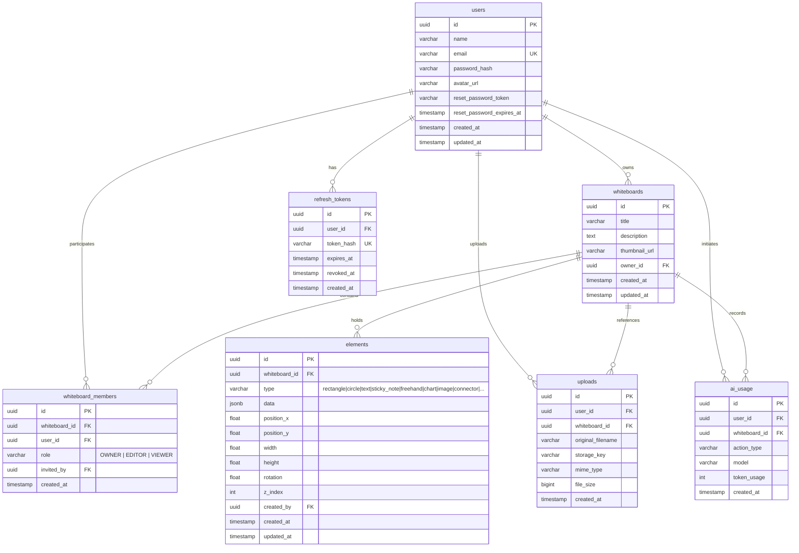

# Database Schema Specification – AI Whiteboard

## 1. Overview

The database uses standard **PostgreSQL** with UUID primary keys (`gen_random_uuid()`), relational foreign key constraints with cascading deletes where appropriate, and flexible `JSONB` fields for complex element attributes (styles, chart datasets, stroke points).

---

## 2. Entity-Relationship Overview

---

## 3. Detailed Table Specifications

### 3.1 `users`
| Column | Type | Constraints | Description |
|---|---|---|---|
| `id` | `UUID` | PK, Default `gen_random_uuid()` | Unique user identifier |
| `name` | `VARCHAR(100)` | NOT NULL | User's full display name |
| `email` | `VARCHAR(255)` | NOT NULL, UNIQUE, Indexed | Normalized lower-case email address |
| `password_hash` | `VARCHAR(255)` | NOT NULL | bcrypt hashed password |
| `avatar_url` | `VARCHAR(500)` | NULL | Profile image link |
| `reset_password_token` | `VARCHAR(255)` | NULL | SHA-256 hash of password reset token |
| `reset_password_expires_at`| `TIMESTAMP` | NULL | Expiration timestamp for reset token |
| `created_at` | `TIMESTAMP` | NOT NULL, Default `NOW()` | Timestamp of creation |
| `updated_at` | `TIMESTAMP` | NOT NULL, Default `NOW()` | Timestamp of last modification |

### 3.2 `whiteboards`
| Column | Type | Constraints | Description |
|---|---|---|---|
| `id` | `UUID` | PK, Default `gen_random_uuid()` | Board identifier |
| `title` | `VARCHAR(255)` | NOT NULL | Board name |
| `description` | `TEXT` | NULL | Optional markdown description or notes |
| `thumbnail_url` | `VARCHAR(500)` | NULL | Rendered preview thumbnail storage URL |
| `owner_id` | `UUID` | NOT NULL, FK(`users.id`), ON DELETE CASCADE | Board creator and ultimate administrator |
| `created_at` | `TIMESTAMP` | NOT NULL, Default `NOW()` | Creation date |
| `updated_at` | `TIMESTAMP` | NOT NULL, Default `NOW()` | Modification date |

### 3.3 `whiteboard_members`
| Column | Type | Constraints | Description |
|---|---|---|---|
| `id` | `UUID` | PK, Default `gen_random_uuid()` | Membership record identifier |
| `whiteboard_id`| `UUID` | NOT NULL, FK(`whiteboards.id`), ON DELETE CASCADE | Associated whiteboard |
| `user_id` | `UUID` | NOT NULL, FK(`users.id`), ON DELETE CASCADE | Member user |
| `role` | `VARCHAR(20)` | NOT NULL, Default `'EDITOR'` | Role: `'OWNER'`, `'EDITOR'`, or `'VIEWER'` |
| `invited_by` | `UUID` | NULL, FK(`users.id`), ON DELETE SET NULL | Inviting user |
| `created_at` | `TIMESTAMP` | NOT NULL, Default `NOW()` | Date added |

*Unique Index:* `UNIQUE(whiteboard_id, user_id)`

### 3.4 `elements`
| Column | Type | Constraints | Description |
|---|---|---|---|
| `id` | `UUID` | PK, Default `gen_random_uuid()` | Element identifier |
| `whiteboard_id`| `UUID` | NOT NULL, FK(`whiteboards.id`), ON DELETE CASCADE | Target whiteboard |
| `type` | `VARCHAR(50)` | NOT NULL | Element classification |
| `data` | `JSONB` | NOT NULL | Type-specific JSON payload (colors, points, chart data) |
| `position_x` | `DOUBLE PRECISION`| NOT NULL, Default 0.0 | Canvas X coordinate (world space) |
| `position_y` | `DOUBLE PRECISION`| NOT NULL, Default 0.0 | Canvas Y coordinate (world space) |
| `width` | `DOUBLE PRECISION`| NOT NULL, Default 100.0 | Bounding width |
| `height` | `DOUBLE PRECISION`| NOT NULL, Default 100.0 | Bounding height |
| `rotation` | `DOUBLE PRECISION`| NOT NULL, Default 0.0 | Rotation in degrees (0 - 360) |
| `z_index` | `INTEGER` | NOT NULL, Default 0 | Layer stacking order |
| `created_by` | `UUID` | NULL, FK(`users.id`), ON DELETE SET NULL | Author user ID |
| `created_at` | `TIMESTAMP` | NOT NULL, Default `NOW()` | Creation date |
| `updated_at` | `TIMESTAMP` | NOT NULL, Default `NOW()` | Modification date |

*Indexes:*
- `INDEX(whiteboard_id)`
- `INDEX(whiteboard_id, z_index)`

#### Element `data` JSONB Structure by Type
- **`sticky_note`**: `{"text": string, "color": string, "fontSize": number}`
- **`text`**: `{"text": string, "fontSize": number, "fontFamily": string, "fontWeight": string, "fontStyle": string, "textDecoration": string, "textAlign": string, "color": string}`
- **`shape`** (`rectangle`, `ellipse`, `triangle`, `diamond`, `star`, etc.): `{"fill": string, "stroke": string, "strokeWidth": number, "opacity": number, "borderRadius": number, "roughness": number}`
- **`freehand`**: `{"points": [[x, y, pressure], ...], "stroke": string, "strokeWidth": number, "tool": "pen"|"pencil"|"highlighter"|"eraser"}`
- **`chart`**: `{"chartType": "bar"|"line"|"pie"|"donut", "title": string, "labels": string[], "datasets": [{"label": string, "data": number[], "backgroundColor": string[]}]}`
- **`image`**: `{"url": string, "storageKey": string, "originalWidth": number, "originalHeight": number, "aspectRatio": number}`
- **`connector`**: `{"startElementId": string|null, "endElementId": string|null, "startPoint": [x,y], "endPoint": [x,y], "style": "straight"|"curved"|"orthogonal", "startArrow": boolean, "endArrow": boolean, "stroke": string, "strokeWidth": number}`

### 3.5 `ai_usage`
| Column | Type | Constraints | Description |
|---|---|---|---|
| `id` | `UUID` | PK, Default `gen_random_uuid()` | Audit log identifier |
| `user_id` | `UUID` | NOT NULL, FK(`users.id`), ON DELETE CASCADE | Requesting user |
| `whiteboard_id`| `UUID` | NULL, FK(`whiteboards.id`), ON DELETE CASCADE | Associated whiteboard |
| `action_type` | `VARCHAR(50)` | NOT NULL | e.g. `brainstorm`, `diagram`, `chart`, `summary` |
| `model` | `VARCHAR(50)` | NOT NULL | e.g. `gemini-2.5-flash` or `gemini-1.5-pro` |
| `token_usage` | `INTEGER` | NOT NULL, Default 0 | Total token consumption |
| `created_at` | `TIMESTAMP` | NOT NULL, Default `NOW()` | Execution timestamp |

### 3.6 `refresh_tokens`
| Column | Type | Constraints | Description |
|---|---|---|---|
| `id` | `UUID` | PK, Default `gen_random_uuid()` | Token record identifier |
| `user_id` | `UUID` | NOT NULL, FK(`users.id`), ON DELETE CASCADE | Token recipient |
| `token_hash` | `VARCHAR(255)` | NOT NULL, UNIQUE, Indexed | SHA-256 hash of refresh token |
| `expires_at` | `TIMESTAMP` | NOT NULL | Expiry date |
| `revoked_at` | `TIMESTAMP` | NULL | Timestamp of revocation if invalidated |
| `created_at` | `TIMESTAMP` | NOT NULL, Default `NOW()` | Issuance timestamp |

### 3.7 `uploads`
| Column | Type | Constraints | Description |
|---|---|---|---|
| `id` | `UUID` | PK, Default `gen_random_uuid()` | Upload metadata ID |
| `user_id` | `UUID` | NOT NULL, FK(`users.id`), ON DELETE CASCADE | Uploader |
| `whiteboard_id`| `UUID` | NULL, FK(`whiteboards.id`), ON DELETE SET NULL | Target whiteboard |
| `original_filename`| `VARCHAR(255)`| NOT NULL | Original file name |
| `storage_key` | `VARCHAR(500)` | NOT NULL, UNIQUE | S3/MinIO bucket key |
| `mime_type` | `VARCHAR(100)` | NOT NULL | Validated image MIME type |
| `file_size` | `BIGINT` | NOT NULL | Size in bytes (up to 5MB) |
| `created_at` | `TIMESTAMP` | NOT NULL, Default `NOW()` | Upload date |
