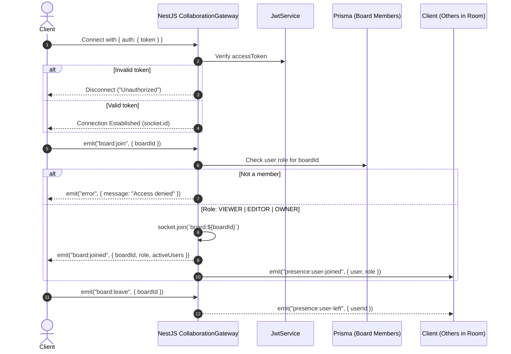

# WebSocket Real-Time Collaboration Events – AI Whiteboard

## 1. Overview

Real-time collaboration is powered by NestJS WebSocket Gateway and Socket.IO.
- **Transport:** WebSocket (`wss://` in production, `ws://` in development) with polling fallback.
- **Authentication:** Handshake authentication via `auth: { token: "<JWT_ACCESS_TOKEN>" }` or Authorization header.
- **Rooms:** Each whiteboard is an isolated Socket.IO room named `board:<boardId>`.
- **Authorization:** Before allowing a client to join `board:<boardId>`, the gateway verifies the user is an OWNER, EDITOR, or VIEWER.

---

## 2. Connection Lifecycle

---

## 3. Event Specifications

### 3.1 Client to Server (Inbound Events)

| Event Name | Role Required | Payload | Description |
|---|---|---|---|
| `board:join` | VIEWER+ | `{ "boardId": string }` | Join room and retrieve active collaborators |
| `board:leave` | VIEWER+ | `{ "boardId": string }` | Gracefully exit room |
| `cursor:move` | VIEWER+ | `{ "boardId": string, "x": number, "y": number }` | Throttled live cursor update (every 40-50ms) |
| `element:create` | EDITOR+ | `{ "boardId": string, "element": ElementObject }` | Broadcast newly created element |
| `element:update` | EDITOR+ | `{ "boardId": string, "element": Partial<ElementObject> }` | Broadcast element updates (drag/resize/color) |
| `element:delete` | EDITOR+ | `{ "boardId": string, "elementId": string }` | Broadcast element removal |
| `elements:bulk-update`| EDITOR+ | `{ "boardId": string, "elements": ElementObject[] }` | Multi-select movement/rotation update |
| `draw:stroke-live` | EDITOR+ | `{ "boardId": string, "strokeId": string, "point": [x, y, pressure], "color": string, "width": number }` | Real-time stroke broadcasting while drawing |
| `draw:stroke-end` | EDITOR+ | `{ "boardId": string, "element": ElementObject }` | Stroke finalized and committed |

---

### 3.2 Server to Client (Outbound Broadcasts)

| Event Name | Target | Payload | Description |
|---|---|---|---|
| `board:joined` | Sender | `{ "boardId": string, "role": string, "activeUsers": UserPresence[] }` | Confirms room entry and lists current participants |
| `presence:user-joined` | Room (others) | `UserPresence` (`{ id, name, email, avatarUrl, color, role }`) | Informs room that a collaborator joined |
| `presence:user-left` | Room (others) | `{ "userId": string }` | Informs room that a collaborator disconnected |
| `presence:cursor-moved`| Room (others) | `{ "userId": string, "x": number, "y": number }` | Renders collaborator's moving cursor with name tag |
| `element:created` | Room (others) | `{ "element": ElementObject, "userId": string }` | Inserts element into remote canvases |
| `element:updated` | Room (others) | `{ "element": Partial<ElementObject>, "userId": string }` | Updates element attributes on remote canvases |
| `element:deleted` | Room (others) | `{ "elementId": string, "userId": string }` | Removes element from remote canvases |
| `elements:bulk-updated`| Room (others)| `{ "elements": ElementObject[], "userId": string }` | Synchronizes multi-element operations |
| `draw:stroke-live` | Room (others) | `{ "strokeId": string, "point": [x, y, pressure], ... }` | Renders remote drawing in-flight |
| `draw:stroke-ended` | Room (others) | `{ "element": ElementObject }` | Commits finalized stroke |
| `error` | Sender | `{ "message": string, "code": string }` | Gateway error notification |

---

## 4. Performance & Safety Measures

1. **Cursor Throttling:** Cursors are throttled on the client to at most once every 40ms (~25 FPS) using `requestAnimationFrame` and timestamp checks.
2. **Ephemeral Updates:** Live cursor coordinates and mid-stroke drawing points are never written to the PostgreSQL database.
3. **Transaction Batching:** Finalized positions, shapes, and text changes are persisted with batching and database transactions.
4. **Heartbeat & Disconnect Cleaning:** Socket.IO ping/pong intervals clean up stale presence when tabs close abruptly.
